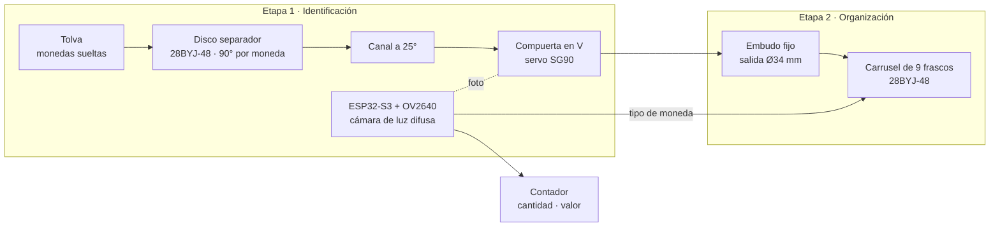
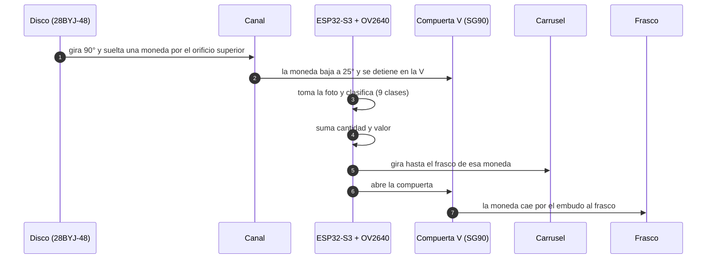
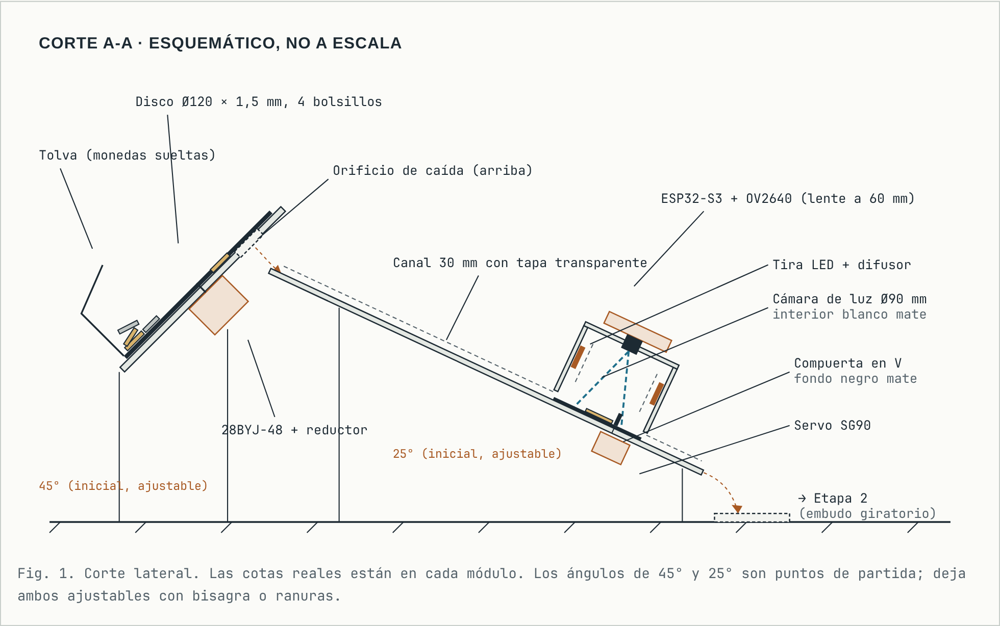
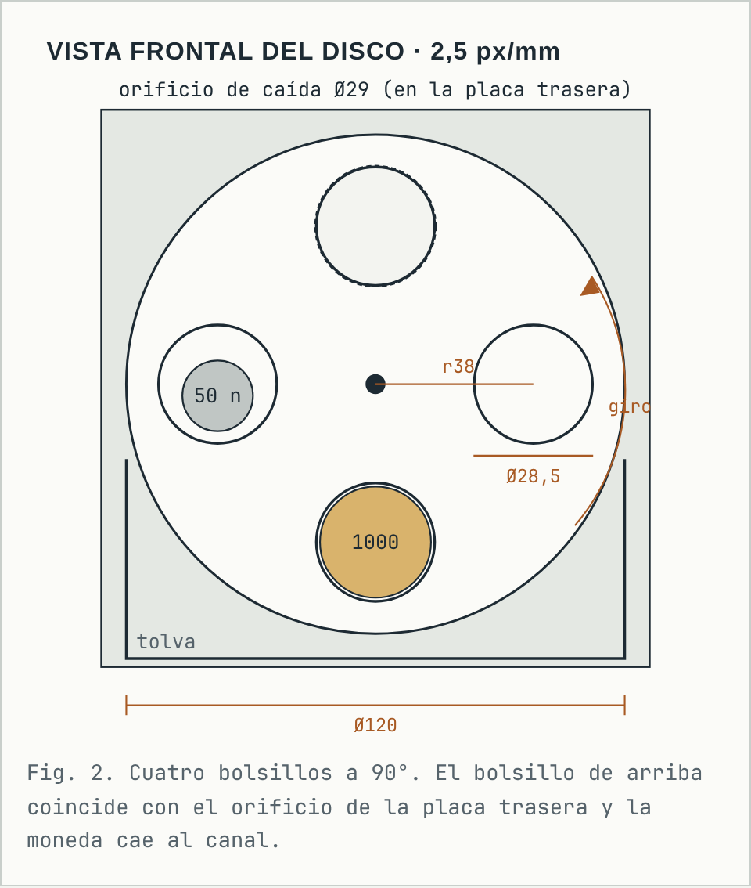
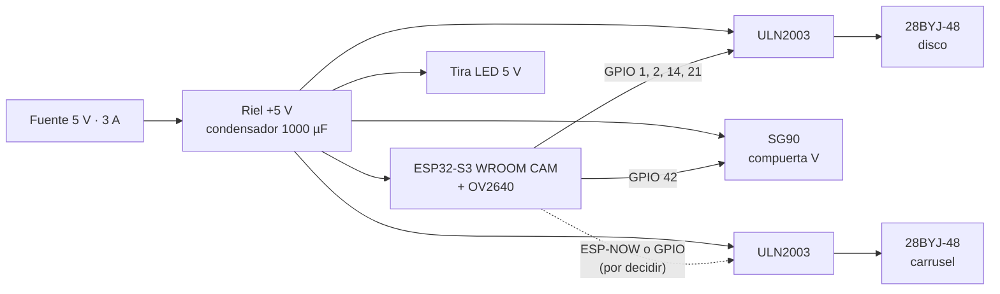
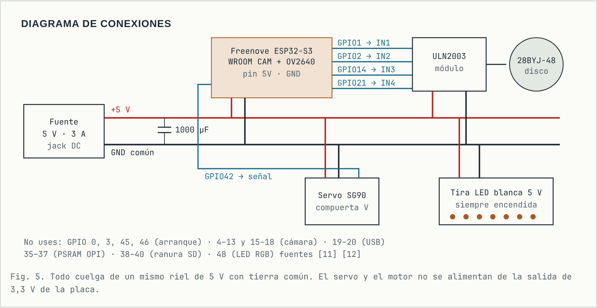
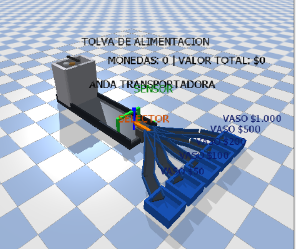
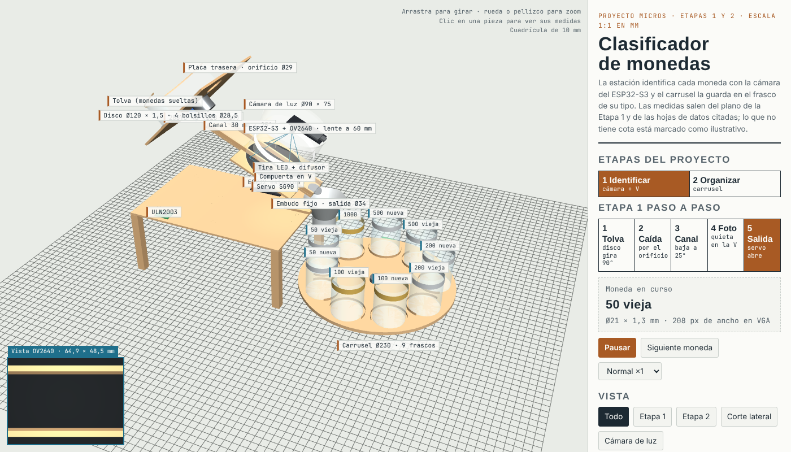

# Contador y Clasificador de Monedas con ESP32-S3

**Universidad Militar Nueva Granada – Ingeniería Mecatrónica · Campus Cajicá**<br>
**Asignatura:** Micros y Laboratorio<br>
**Grupo 5** · Selector en cadena de vasos de monedas por visión computacional, control por ESP32 y aparcamiento por voz<br>
**Integrantes:**

- Maria Fernanda Peñuela Romero
- Juan David Artunduaga Diaz
- Alix Estefanía Maldonado Roa

El objetivo del proyecto es un **sistema de manejo de monedas colombianas** basado en **ESP32 y ESP32-S3**, dividido en cuatro etapas: identificar las monedas, guardarlas en su frasco, recoger por comando de voz el frasco pedido con un carro robótico y llevarlo a una meta esquivando de 3 a 5 obstáculos. Las monedas a reconocer son nueve: $50 vieja y nueva, $100 vieja y nueva, $200 vieja y nueva, $500 vieja y nueva, y $1.000.

Este repositorio reúne la **entrega (a): el contador de monedas montado de forma funcional**, con su **repositorio mecánico y eléctrico completo**. Cubre las Etapas 1 y 2. Las Etapas 3 y 4 (voz, carro y obstáculos) se presentarán en entregas siguientes.

| Módulo | Qué hace | Tecnología | Estado |
|---|---|---|---|
| **Alimentador de disco** | Recibe todas las monedas juntas en una tolva y sube una sola moneda por cada giro de 90° | Motor paso a paso 28BYJ-48 + ULN2003 | Diseñado y simulado en 3D · Montaje: _pendiente_ |
| **Estación de identificación** | Detiene cada moneda contra una compuerta en V, bajo la cámara, dentro de una cámara de luz difusa | ESP32-S3 (8 MB PSRAM) + OV2640 + tira LED | Diseñado y simulado en 3D · Montaje: _pendiente_ |
| **Compuerta en V** | Centra la moneda para la foto y la suelta hacia la Etapa 2 | Servo SG90 | Diseñado y simulado en 3D · Montaje: _pendiente_ |
| **Carrusel de 9 frascos** | Pone bajo un embudo fijo el frasco que corresponde a la moneda identificada | 28BYJ-48 + ULN2003 | Diseñado y simulado en 3D · Montaje: _pendiente_ |
| **Clasificador de imágenes** | Decide cuál de las 9 monedas está bajo la cámara | _Por definir_ | _Pendiente_ |
| **Contador** | Suma la cantidad y el valor por denominación | _Por definir_ | _Pendiente_ |

**Resultados principales de esta entrega**

> ⚠️ **Plantilla.** Esta tabla se llena con datos medidos en el montaje real. No hay resultados todavía.

| | Resultado |
|---|---|
| Separación de monedas | _Pendiente:_ en 100 ciclos con 20 monedas en la tolva, cuántas veces salen 0, 1 o 2 monedas |
| Identificación | _Pendiente:_ aciertos sobre un conjunto de prueba que el modelo no haya visto |
| Clasificación en frascos | _Pendiente:_ monedas que terminan en el frasco correcto de N lanzadas |
| Conteo | _Pendiente:_ valor contado contra valor real |

---

## Contenido

1. [Arquitectura del sistema](#1-arquitectura-del-sistema)
2. [Diseño mecánico](#2-diseño-mecánico)
3. [Diseño eléctrico](#3-diseño-eléctrico)
4. [Simulaciones](#4-simulaciones)
5. [Identificación y conteo](#5-identificación-y-conteo)
6. [Materiales y software](#6-materiales-y-software)
7. [Paso a paso para replicarlo](#7-paso-a-paso-para-replicarlo)
8. [Estructura del repositorio](#8-estructura-del-repositorio)
9. [Riesgos identificados y problemas comunes](#9-riesgos-identificados-y-problemas-comunes)
10. [Estado del proyecto y próximos pasos](#10-estado-del-proyecto-y-próximos-pasos)
11. [Conclusiones](#11-conclusiones)
12. [Referencias](#12-referencias)

---

## 1. Arquitectura del sistema

### 1.1 Diagrama de bloques

Las monedas se echan juntas en una tolva. Un disco inclinado las separa de una en una, cada moneda baja por un canal y se detiene bajo la cámara. El ESP32-S3 la identifica, suma su valor y ordena girar el carrusel hasta el frasco correcto. Luego el servo abre la compuerta y la moneda cae por un embudo fijo al frasco.



### 1.2 Recorrido de una moneda



### 1.3 Reparto de microcontroladores

| Placa | Tareas | Estado |
|---|---|---|
| ESP32-S3 con cámara (8 MB PSRAM) | Cámara, clasificación, conteo, disco separador y compuerta en V | Diseñado |
| ESP32 (opcional) | Carrusel de frascos, comandado por ESP-NOW desde el ESP32-S3 | Propuesto. _Por decidir:_ si al ESP32-S3 le quedan 4 GPIO libres, también puede mover el carrusel y esta placa sobra |

Se eligió el **ESP32-S3** para la cámara porque el driver `esp32-camera` exige PSRAM salvo en resoluciones CIF o menores con JPEG [10], y la placa Freenove ESP32-S3-WROOM trae 8 MB de PSRAM [11].

---

## 2. Diseño mecánico



*Corte lateral esquemático (no a escala): tolva y disco inclinado, canal a 25°, cámara de luz con la cámara, compuerta en V con servo y salida hacia la Etapa 2.*

Cada cifra lleva su origen: **Dato** viene de una fuente citada, **Cálculo** se derivó de datos citados y **Supuesto** es un valor de partida que se debe comprobar en el montaje.

### 2.1 Datos de las monedas

| Moneda | Diámetro | Peso | Material |
|---|---|---|---|
| $50 vieja | 21,8 mm | 4,5 g | Cobre-níquel-zinc |
| $50 nueva | 17 mm | 2,0 g | Acero recubierto de níquel |
| $100 vieja | 23 mm | 5,31 g | Aluminio-bronce |
| $100 nueva | 20,3 mm | 3,34 g | Acero con capa de latón |
| $200 vieja | 24,4 mm | 7,08 g | 65 % Cu, 20 % Zn, 15 % Ni |
| $200 nueva | 22,4 mm | 4,61 g | Alpaca |
| $500 vieja | 23,5 mm | 7,43 g | Bimetálica |
| $500 nueva | 23,7 mm | 7,14 g | Bimetálica |
| $1.000 | 26,7 mm | 9,95 g | Bimetálica |

**Por qué se usa visión y no tamaño o peso.** Cinco monedas caben en un rango de 2 mm de diámetro, y la $500 vieja y la $500 nueva difieren solo 0,2 mm y 0,29 g. Con la cámara propuesta, 0,2 mm son unos 2 píxeles, así que lo que las distingue es el diseño grabado.

> Las fuentes no coinciden en algunos datos (por ejemplo, Wikipedia da 21 mm para la $50 vieja [5]). _Pendiente:_ medir nuestras monedas con calibrador y balanza y actualizar esta tabla.

### 2.2 Módulo 1: alimentador de disco



| Parámetro | Valor | Origen |
|---|---|---|
| Disco | Ø120 × 1,5 mm, acrílico o impresión 3D | Dato |
| Bolsillos | 4 × Ø28,5 mm a radio 38 mm | Cálculo: moneda de $1.000 (26,7 mm) + holgura |
| Orificio de caída en la placa trasera | Ø29 mm, arriba | Dato |
| Inclinación del disco | 45° de partida, ajustable entre 40° y 60° | Supuesto |
| Giro por moneda | 90° = 1024 medios pasos del 28BYJ-48 | Cálculo [15] |
| Par necesario | ≈ 111 gf·cm contra 300 gf·cm del motor (margen ≈ 2,7×) | Cálculo, con fricción μ = 0,3 supuesta |

**Decisiones de diseño**

- **Disco de bolsillos en vez de echar todas bajo la cámara.** Dos clasificadores de Cornell que funcionaron usan un plato giratorio que sube una moneda y la suelta en un punto fijo [1][2], el mismo principio de los alimentadores comerciales de disco inclinado [18].
- **Motor paso a paso en vez de servo continuo.** Con servo continuo, girar rápido soltaba dos monedas a la vez [2], y sin realimentación el disco se desalineaba [1]. El paso a paso gira exactamente 90° sin sensor.
- **Espesor de 1,5 mm.** La moneda más delgada mide 1,3 mm. Una segunda moneda montada encima solo queda apoyada 0,2 mm y la inclinación la hace resbalar de vuelta a la tolva. Es un argumento geométrico que falta probar.
- **Dos monedas de $50 nueva no caben juntas** en un bolsillo: 2 × 17 = 34 mm > 28,5 mm.

### 2.3 Módulo 2: canal de bajada

| Parámetro | Valor | Origen |
|---|---|---|
| Pendiente | 25° de partida, ajustable | Dato [3]: con 10° no bajaban y con 30° se aceleraban demasiado |
| Ancho interior | 30 mm | Cálculo |
| Alto de paredes | 6 mm | Cálculo (moneda más gruesa: 2,7 mm) |
| Largo | 150 a 200 mm | Supuesto |
| Tapa | Acrílico transparente de 2 mm | Dato [3]: sin tapa las monedas saltaban fuera |

### 2.4 Módulo 3: cámara e iluminación

```
Sensor OV2640: 3,59 × 2,684 mm [6] · lente de 68° (se asume diagonal) [7]
Focal ≈ 3,3 mm
A 60 mm de la lente:  encuadre ≈ 64,9 × 48,5 mm
En VGA (640 × 480):   ≈ 9,9 px/mm
   moneda de $1.000 ≈ 264 px · moneda de $50 nueva ≈ 168 px
```

| Parámetro | Valor | Origen |
|---|---|---|
| Distancia lente → fondo | 60 mm | Cálculo |
| Cámara de luz | Tubo Ø90 mm interior × 75 mm, blanco mate por dentro | Cálculo |
| Iluminación | Tira LED blanca de 5 V tras un difusor de papel mantequilla, siempre encendida | Dato [8][13] |
| Fondo | Cartulina negra mate | Dato [1] |
| Orificio para la lente | Ø12 mm en la tapa | Dato |
| Ranuras de paso de la moneda | 32 × 6 mm en la base | Dato |

**Decisiones de diseño**

- **La moneda se fotografía quieta**, no en movimiento: en una rampa, los reflejos y la velocidad irregular estorbaron la detección [1].
- **Luz difusa envolvente.** Para metal brillante se recomienda luz tipo domo, que suprime reflejos [13][14], y el LED directo se corrige con un difusor de papel [8].
- **Hay que reenfocar la cámara.** La OV2640 viene enfocada para más de ~40 cm. Para 60 mm se retira el pegamento de la lente y se gira sujetando el módulo [8]. Existe una llave impresa en 3D para hacerlo [9].
- **La cámara va perpendicular al fondo**, es decir inclinada 25° igual que el canal [1].

### 2.5 Módulo 4: compuerta en V

- Dos brazos a 90° de 3 mm de alto que cruzan el canal. Una moneda redonda que llega a la V queda centrada a lo ancho sin importar su tamaño.
- Montada en el brazo de un **SG90** bajo el canal (1,8 kg·cm a 4,8 V, 60° en 0,1 s [16]). Al girar, la V baja por debajo del piso y la moneda sigue.

### 2.6 Etapa 2: embudo fijo y carrusel de frascos

| Parámetro | Valor | Origen |
|---|---|---|
| Embudo | Fijo, boca Ø60 mm, salida Ø34 mm | Boca: supuesto · salida: cálculo |
| Plato del carrusel | Ø230 × 5 mm | Cálculo |
| Frascos | 9, a radio 85 mm, uno cada 40° | Cálculo |
| Tamaño de frasco | Ø45 × 60 mm | Supuesto: debe ser más ancho que la salida del embudo |
| Motor | 28BYJ-48 + ULN2003 en la base | Dato |
| Giro por frasco | 40° = 455,1 medios pasos | Cálculo |
| Alto de la mesa de la estación | 100 mm | Cálculo |

**Decisiones de diseño**

- **Carrusel en vez de embudo giratorio.** El embudo queda fijo y un solo motor pone debajo el frasco correcto. Cada frasco ocupa siempre la misma posición, lo que también facilita que el carro de la Etapa 3 lo recoja en un punto fijo.
- **Sensor de inicio obligatorio.** Como 40° no da un número entero de pasos, cada posición se calcula desde un fin de carrera o sensor Hall en vez de sumar giros.
- **Par del carrusel no medido.** Si el 28BYJ-48 patina con los frascos llenos, se apoya el plato en un rodamiento de tornamesa o se cambia a un NEMA 17.

### 2.7 Planos y CAD

> ⚠️ **Pendiente.** Aquí van los planos acotados y los archivos CAD de cada pieza.

| Pieza | Archivo | Estado |
|---|---|---|
| Disco separador | `mecanica/disco.[dxf/stl]` | _Pendiente_ |
| Placa trasera y tolva | `mecanica/placa_tolva.[dxf/stl]` | _Pendiente_ |
| Canal y tapa | `mecanica/canal.[dxf/stl]` | _Pendiente_ |
| Cámara de luz | `mecanica/camara_luz.[dxf/stl]` | _Pendiente_ |
| Compuerta en V | `mecanica/compuerta_v.stl` | _Pendiente_ |
| Embudo y carrusel | `mecanica/carrusel.[dxf/stl]` | _Pendiente_ |

---

## 3. Diseño eléctrico

### 3.1 Diagrama de bloques



### 3.2 Diagrama de conexiones



> _Pendiente:_ esquema eléctrico formal (KiCad, Fritzing u otro) con el carrusel incluido.

### 3.3 Conexiones

| ESP32-S3 | Destino | Función | Origen |
|---|---|---|---|
| GPIO 1 / 2 / 14 / 21 | ULN2003 IN1 / IN2 / IN3 / IN4 | Bobinas del motor del disco | Pines libres según Freenove [12] |
| GPIO 42 | SG90 señal | Compuerta en V | Supuesto: confirmar en la serigrafía de la placa |
| GPIO 4–13, 15–18 | OV2640 | Cámara | Ya cableada en la placa [12] |
| 5V / GND | Riel de 5 V | Alimentación | – |
| _Por definir_ | ULN2003 del carrusel + sensor de inicio | Carrusel de frascos | _Pendiente_ |

**Pines que no se deben usar:** 0, 3, 45 y 46 (arranque), 4–13 y 15–18 (cámara), 19–20 (USB), 35–37 (PSRAM), 38–40 (ranura SD) y 48 (LED RGB) [11][12].

### 3.4 Presupuesto de corriente

| Carga | Corriente | Origen |
|---|---|---|
| Placa + cámara | ≈ 0,50 A | Mínimo recomendado [19] |
| 28BYJ-48 (disco) | ≈ 0,20 A | Cálculo: 5 V / 50 Ω por bobina, 2 bobinas [15] |
| SG90 | ≤ 0,55 A | Con el eje bloqueado [16] |
| Tira LED | ≈ 0,50 A | Supuesto: medir con multímetro |
| **Total (sin carrusel)** | **≈ 1,75 A** | Fuente de 3 A |
| 28BYJ-48 (carrusel) | ≈ 0,20 A | Cálculo, igual al del disco |

**Decisiones de diseño**

- **Un solo riel de 5 V con tierra común.** El servo y los motores no se alimentan de la salida de 3,3 V de la placa [17].
- **Condensador de 1000 µF** entre +5 V y GND, cerca del servo y la tira LED [17].
- **Al programar por USB se desconecta el +5 V externo** del pin 5V de la placa, porque no se confirmó que la placa tenga protección contra alimentación inversa.

---

## 4. Simulaciones

### 4.1 Planta en PyBullet



*Planta simulada en PyBullet: tolva de alimentación, banda transportadora, sensor, selector y cinco canaletas que llevan cada moneda a su vaso ($50, $100, $200, $500 y $1.000). Arriba se muestra el contador de monedas y el valor total.*

> _Pendiente:_ describir el modelo (archivo URDF, script y cómo se mueven la banda y el selector) y los resultados de la simulación.

### 4.2 Modelo 3D interactivo de la estación

Antes de comprar materiales se hizo un **modelo 3D a escala 1:1 en milímetros** de las Etapas 1 y 2. Se puede girar, hacer zoom, tocar cada pieza para ver sus medidas y su origen (dato, cálculo o ilustrativo), y ver la animación del recorrido completo: el disco gira, la moneda baja por el canal, se detiene en la V, se toma la foto, el servo abre y la moneda cae en su frasco. Incluye una ventana con lo que vería la OV2640.

🔗 **Modelo 3D:** [Clasificador de monedas 3D](https://claude.ai/code/artifact/35f0871e-c78c-4fe5-aba9-43928463f560)<br>
🔗 **Plano de montaje de la Etapa 1:** [Estación de identificación de monedas](https://claude.ai/code/artifact/97f019aa-f567-443f-bbc9-ae76436a3850)



*Captura del modelo 3D: estación de identificación (Etapa 1) y carrusel de 9 frascos (Etapa 2).*

**Limitaciones del modelo:** la base, la tolva y el tamaño de los frascos son ilustrativos porque no tienen cota. El cuerpo del 28BYJ-48 está dibujado centrado en su eje (en el motor real el eje está descentrado). El cableado y la fuente no están dibujados.

---

## 5. Identificación y conteo

> ⚠️ **Pendiente.** Esta sección se completa cuando exista el programa.

**Plan propuesto (a validar):**

1. Fotografiar las 9 monedas por ambas caras **dentro del montaje final**, con la luz y la altura definitivas.
2. Medir el diámetro en píxeles para descartar clases imposibles.
3. Clasificar el recorte de la moneda entre las 9 clases con un modelo ligero.
4. Evaluar con fotos que el modelo no haya visto en el entrenamiento.

| Elemento | Estado |
|---|---|
| Dataset (fotos por moneda y por cara) | _Pendiente_ |
| Modelo y dónde corre (ESP32-S3 o PC) | _Por definir_ |
| Resultados y matriz de confusión | _Pendiente_ |
| Firmware de la estación | _Pendiente_ |

---

## 6. Materiales y software

**Hardware**

| Cant. | Componente | Para qué |
|---|---|---|
| 1 | Freenove ESP32-S3-WROOM CAM (8 MB PSRAM) con OV2640 de 68° | Captura y clasificación |
| 2 | Motor 28BYJ-48 5 V + módulo ULN2003 | Disco separador y carrusel |
| 1 | Servo SG90 | Compuerta en V |
| 1 | Tira LED blanca 5 V, unos 30 cm | Cámara de luz |
| 1 | Fuente 5 V 3 A con jack DC + bornera | Alimentación |
| 1 | Condensador electrolítico 1000 µF ≥ 6,3 V | Riel de 5 V |
| 1 | Fin de carrera o sensor Hall | Posición de inicio del carrusel |
| 9 | Frascos (≥ Ø41 mm de boca) | Etapa 2 |
| 1 | Lámina de acrílico 1,5 mm (o impresión 3D) | Disco |
| 1 | MDF 3 mm | Placa trasera, tolva, canal, base, mesa y plato |
| 1 | Acrílico transparente 2 mm, 35 × 200 mm | Tapa del canal |
| 1 | Tubo Ø90 mm interior × 75 mm (PVC o cartulina) | Cámara de luz |
| – | Cartulina negra mate, papel mantequilla, pintura blanca mate | Fondo y difusor |
| – | Bisagra pequeña, tornillos M3, cables dupont, regla milimetrada impresa | Ajuste de ángulos y calibración |
| 1 | ESP32 (opcional) | Carrusel, si el ESP32-S3 no tiene pines libres |

**Presupuesto:** _Pendiente_ (precios en Colombia).

**Software**

| Herramienta | Versión | Uso |
|---|---|---|
| _Por definir_ (Arduino IDE / PlatformIO / ESP-IDF) | – | Firmware |
| _Por definir_ | – | Entrenamiento del clasificador |
| _Por definir_ (KiCad, Fritzing u otro) | – | Esquema eléctrico |
| _Por definir_ (SolidWorks, Fusion 360, Onshape u otro) | – | CAD |

---

## 7. Paso a paso para replicarlo

El montaje se hace **de la prueba más barata a la más cara**, para no construir en material definitivo algo que no funciona.

### Paso 1: Cámara de luz en cartón

1. Monta el tubo, la tira LED y el difusor sobre cartulina negra.
2. Enfoca la OV2640 a 60 mm mirando una regla milimetrada.
3. Con esa misma foto, comprueba que el lado corto del encuadre mide entre 45 y 50 mm y anota los px/mm reales.
4. Fotografía las 9 monedas por ambas caras. Si los reflejos tapan el grabado, cambia el difusor antes de seguir.

### Paso 2: Disco con el 28BYJ-48

1. Arma el disco y la placa trasera en cartón, con la bisagra a 45°.
2. Con 20 monedas en la tolva, cuenta en 100 ciclos cuántas veces salen 0, 1 o 2 monedas.
3. Ajusta la inclinación entre 40° y 60°.

### Paso 3: Canal y compuerta

1. Comprueba que las 9 monedas llegan y se detienen en la V sin rebotar fuera del encuadre.
2. Ajusta la pendiente.

### Paso 4: Carrusel

1. Arma el plato con los 9 frascos y el sensor de inicio.
2. Comprueba que cada frasco queda centrado bajo el embudo y que el motor no patina con los frascos llenos.

### Paso 5: Versión final

1. Corta las piezas en MDF o acrílico con las medidas que salieron de las pruebas.
2. Cablea según la [sección 3](#3-diseño-eléctrico).
3. Vuelve a tomar las fotos de entrenamiento en el montaje final, porque cualquier cambio de luz o altura cambia las imágenes.

### Paso 6: Firmware

> ⚠️ _Pendiente:_ instrucciones para clonar, compilar y subir el programa.

```bash
git clone https://github.com/[usuario]/[repositorio].git
cd [repositorio]
```

---

## 8. Estructura del repositorio

Estructura propuesta; se actualiza a medida que se suben los archivos.

```
[repositorio]/
├── README.md
├── docs/
│   ├── capturas/          ← modelo 3D, fotos del montaje y videos
│   └── img/               ← esquema eléctrico y planos en imagen
├── mecanica/              ← CAD y archivos de corte o impresión de cada pieza
├── electronica/           ← esquema eléctrico y lista de conexiones
├── firmware/              ← programa del ESP32-S3 (y del ESP32 del carrusel)
└── vision/                ← fotos de entrenamiento, modelo y resultados
```

---

## 9. Riesgos identificados y problemas comunes

Estos riesgos salen de la investigación de diseño. La columna de solución es la medida prevista, todavía sin probar en nuestro montaje.

| Riesgo | Causa | Medida prevista |
|---|---|---|
| La foto sale borrosa | La OV2640 viene enfocada para más de ~40 cm [8] | Quitar el pegamento y girar la lente hasta enfocar a 60 mm |
| Reflejos tapan el grabado | Luz directa sobre metal brillante [8][13] | Difusor de papel y paredes blancas mate; ningún LED apunta directo |
| Punto oscuro en el centro de monedas muy brillantes | Reflejo del orificio de la lente, propio de la luz tipo domo [13] | Es fijo; el clasificador lo aprende si las fotos se toman en el montaje final |
| La luz del salón cambia las fotos | Las luces difusas son tenues [13] | Cámara de luz cerrada, solo con las ranuras de paso |
| Suben dos monedas a la vez | Monedas encimadas en la tolva | Disco de 1,5 mm; medir en 100 ciclos y ajustar la inclinación |
| Las monedas no bajan o saltan del canal | Pendiente incorrecta o rebabas [3] | Ángulo ajustable, superficie lijada y tapa transparente |
| El carrusel pierde la posición | 40° no es un número entero de pasos | Sensor de inicio y posiciones calculadas desde él |
| La placa no arranca o la cámara falla | Pines de arranque, cámara o PSRAM ocupados [12] | Respetar la lista de pines prohibidos de la sección 3.3 |

**Problemas encontrados durante el montaje**

| Problema | Causa | Solución |
|---|---|---|
| _Pendiente_ | | |

---

## 10. Estado del proyecto y próximos pasos

| Requisito de la entrega (a) | Avance |
|---|---|
| Contador de monedas montado de forma funcional | Diseño completo y simulación 3D. _Pendiente:_ montaje físico y prueba |
| Repositorio mecánico | Medidas y decisiones documentadas (sección 2) y modelo 3D. _Pendiente:_ CAD y planos acotados |
| Repositorio eléctrico | Diagrama de bloques, pines y presupuesto de corriente (sección 3). _Pendiente:_ esquema eléctrico y pines del carrusel |

**Siguientes pasos**

1. Medir nuestras monedas y actualizar la tabla de la sección 2.1.
2. Hacer las pruebas en cartón de los pasos 1 a 4.
3. Construir la versión final y subir CAD, planos y esquema eléctrico.
4. Tomar el dataset en el montaje final y entrenar el clasificador.
5. Escribir el firmware de la estación y medir los resultados.
6. Entregas siguientes: recolección por voz (Etapa 3) y evasión de obstáculos (Etapa 4).

---

## 11. Conclusiones

> ⚠️ **Pendiente.** Se redactan con los resultados medidos del montaje.

---

## 12. Referencias

1. Cornell ECE 5725 (2018). *Computer Vision Based Coin Sorting Machine*. https://courses.ece.cornell.edu/ece5990/ECE5725_Spring2018_Projects/sl2954_gc535/website/sample_cool_website/index.html
2. Cornell ECE 5725 (2020). *Coin Sorter*. https://courses.ece.cornell.edu/ece5990/ECE5725_Spring2020_Projects/May_18_Demo/Coin%20Sorter/yw482_zl385_Wednesday/index.html
3. aaronwu. *Diseño de riel y expulsor de monedas* (HackMD). https://hackmd.io/@aaronwu/r1qZmTMUj
4. Collectors Universe. *Numi v4, robot clasificador de monedas*. https://forums.collectors.com/discussion/comment/14138416
5. Wikipedia. *Colombian peso*. https://en.wikipedia.org/wiki/Colombian_peso
6. OmniVision. *OV2640 datasheet* (vía Waveshare). https://files.waveshare.com/wiki/common/OV2640DS_en.pdf
7. Probots. *Módulo OV2640 68°, flex 75 mm*. https://probots.co.in/ov2640-68-degree-2mp-camera-module-24pin-75mm.html
8. jomjol. *AI-on-the-edge: imagen de referencia, enfoque e iluminación*. https://jomjol.github.io/AI-on-the-edge-device-docs/Reference-Image/
9. Printables. *ESP32-CAM OV2640 focus adjustment wrench*. https://www.printables.com/model/877739-esp32-cam-ov2640-focus-adjustment-wrench
10. Espressif Systems. *esp32-camera driver*. https://components.espressif.com/components/espressif/esp32-camera/versions/2.1.6/readme?language=en
11. ESP3D. *Freenove ESP32-S3: flash, PSRAM, LED y SD*. https://esp3d.io/ESP3D/Version_3.X/hardware/esp_boards/esp32-s3/freenove
12. Freenove. *Notas de GPIO, kit ESP32-S3-WROOM*. https://super-starter-kit-for-esp32-s3-wroom.readthedocs.io/en/latest/_sources/preparation/Notes_For_GPIO.rst.txt
13. Vision-Doctor. *Diffuse incident lighting*. https://www.vision-doctor.com/en/illumination-techniques/diffuse-incident-light.html
14. iFactory. *Ring, dome, backlight y dark field*. https://ifactoryapp.com/ai-vision-camera/lighting-design-ai-vision-ring-dome-backlight-dark-field
15. *28BYJ-48 datasheet*. https://pdf.direnc.net/upload/28byj-48-reduktorlu-step-motor-datasheet.pdf
16. Circuit.Rocks. *SG90 9g Servo*. https://docs.circuit.rocks/motors/sg90-servo/
17. Adafruit. *NeoPixel Überguide: best practices*. https://learn.adafruit.com/adafruit-neopixel-uberguide/best-practices
18. Google Patents. *US3422824A, Coin feeding device*. https://patents.google.com/patent/US3422824A/en
19. Cirkit Designer. *ESP32-S3 WROOM CAM devboard*. https://docs.cirkitdesigner.com/component/0f17212d-7f03-40c4-a515-a7fb823581bd/esp32-s3-wroom-cam-devboard
